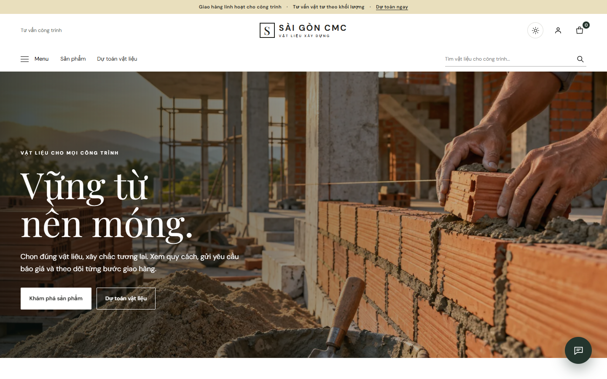
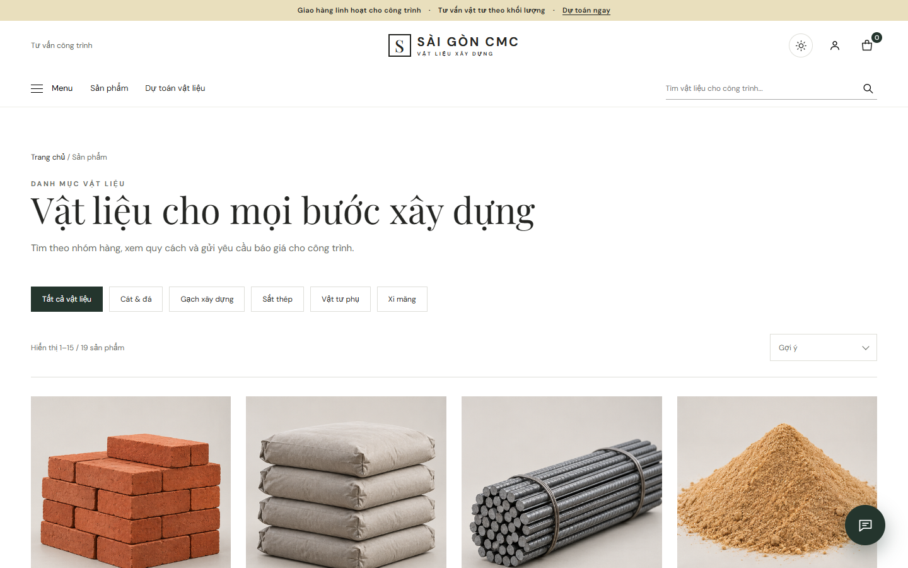
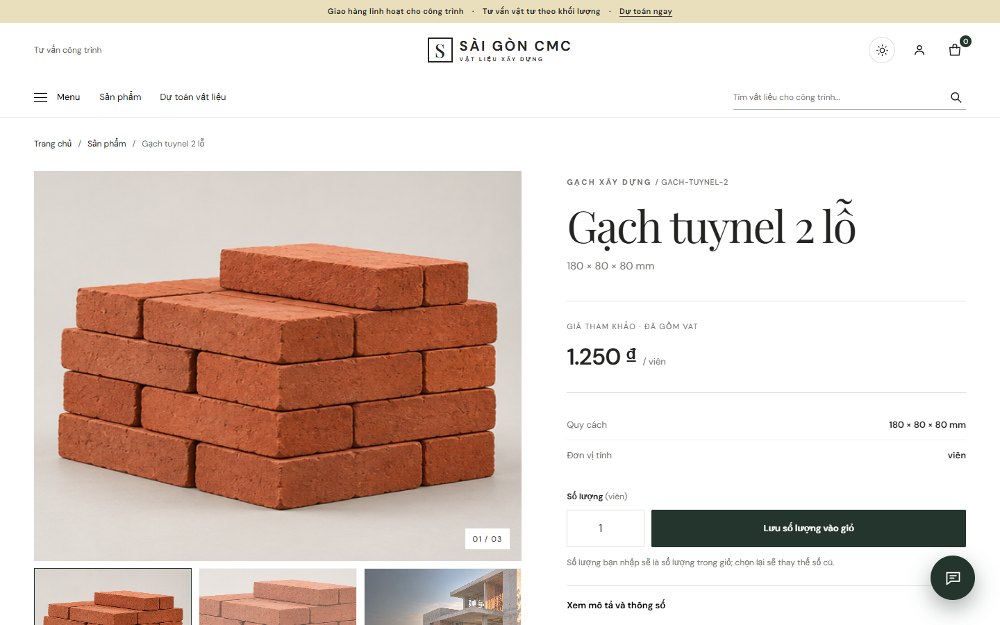

# Sài Gòn CMC — Quản lý vật liệu xây dựng

Ứng dụng chính trong repo này là **Laravel 13 + MySQL** tại [`laravel/`](laravel/). Hệ thống có cửa hàng cho khách, bảng làm việc theo vai trò, quy trình báo giá → hợp đồng → thanh toán → xuất kho → giao nhận, đổi trả và báo cáo. Trợ lý Gemini là tính năng tùy chọn khi có API key.

## Giao diện

| Trang chủ | Danh mục vật liệu |
| --- | --- |
|  |  |



Ảnh được chụp trực tiếp từ ứng dụng Laravel đang chạy ở kích thước 1440 × 900 px.

## Chạy ứng dụng Laravel

Cần PHP 8.3+, Composer và MySQL. Từ thư mục `laravel/`:

```powershell
composer install
Copy-Item .env.example .env
php artisan key:generate
```

Cập nhật `DB_HOST`, `DB_DATABASE`, `DB_USERNAME`, `DB_PASSWORD` trong `.env`, tạo database MySQL tương ứng, rồi chạy:

```powershell
php artisan migrate --seed
php artisan cmms:create-admin admin
php artisan serve
```

Mở địa chỉ do `artisan serve` in ra. Lệnh tạo quản trị viên hỏi mật khẩu tương tác. Điền `GEMINI_API_KEY` trong `.env` nếu dùng trợ lý AI. Không đưa `.env` lên Git.

Xem [hướng dẫn Laravel chi tiết](laravel/README.md) để biết nghiệp vụ, giới hạn hiện tại và các tài khoản kiểm thử đã tạo **trên database của máy phát triển**. Những tài khoản đó không được tạo lại bởi `migrate --seed`.

## Cấu trúc repo

| Thư mục | Nội dung |
| --- | --- |
| [`laravel/`](laravel/) | Ứng dụng PHP/Laravel + MySQL đang phát triển |
| [`customer-prototype/`](customer-prototype/) | Bản mẫu giao diện khách hàng trước khi tích hợp Laravel |

## Kiểm tra

```powershell
cd laravel
php artisan test
```

Ảnh minh họa và dữ liệu seed phục vụ đồ án; cần xác nhận giá, tồn kho và định mức trước khi sử dụng thực tế.
